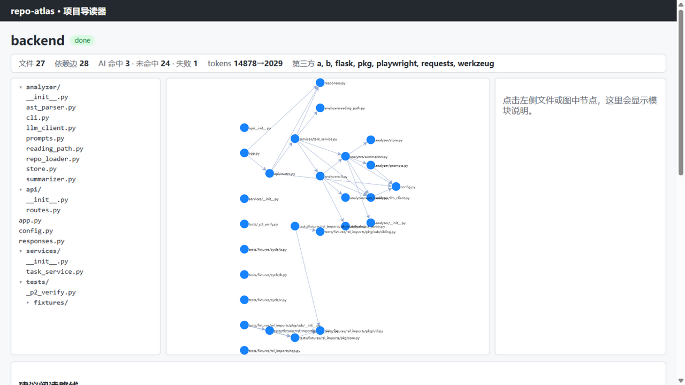

# repo-atlas · 项目导读器

输入一个 Git 仓库地址，告诉你**这个项目是干什么的、文件怎么分层、谁依赖谁、按什么顺序读**。



## 三步跑起来

前置：**Python 3.10+**（用到 `sys.stdlib_module_names`）、**Node 22+**（含 npm）。

> ⚠️ 如果你的机器上装了多个 Python，先确认 `pip` 和 `python` 指向同一个——否则会出现「包明明装了却 import 不到」。
> 不确定就用虚拟环境，最稳：
>
> ```bash
> python -m venv .venv
> .venv\Scripts\activate      # Windows；macOS/Linux 用 source .venv/bin/activate
> ```

**第 1 步：装依赖 + 配置 Key**

```bash
cd backend
pip install -r requirements.txt

# 回到仓库根，把示例配置复制成 .env，填入你的智谱 API Key
# 不填也能跑：结构、依赖图、阅读顺序都正常，只是没有 AI 说明
cd ..
cp .env.example .env        # Windows 用 copy .env.example .env
```

**第 2 步：起后端（端口 5000）**

```bash
cd backend
python app.py
```

**第 3 步：起前端（端口 5173）**

```bash
cd frontend
npm install      # 第一次才需要
npm run dev
```

浏览器打开 <http://localhost:5173>，输入一个本地仓库路径（比如 `C:/path/to/your/repo`）或 git 地址，点「开始分析」。

命令行也能直接用（不需要前端）：

```bash
cd backend
python -m analyzer.cli <仓库路径>            # 文本报告
python -m analyzer.cli <仓库路径> --json     # 机器可读 JSON
python -m analyzer.cli <仓库路径> --with-ai  # 附带每个模块的 AI 说明
```

> **本机备忘（只对这台机器有效，不是通用说明）**：这台开发机上有三个 Python，依赖装在
> `C:/Users/<用户名>/.workbuddy/binaries/python/envs/default/Scripts/python.exe`，
> 跑任何命令时把上面的 `python` 换成这个绝对路径，否则会「装了却 import 不到」。

## 工作原理

整条流水线三段：

1. **解析**：遍历仓库里的 `.py` 文件，用 `ast` 抽出每条 import，归类成「项目内 / 标准库 / 第三方」，拼出文件级依赖图。纯算法，零依赖。
2. **理解**：把每个文件（截断到 import + 签名）连同静态依赖喂给 GLM-4.7-Flash，拿回一句话角色 + 两三句摘要 + 关键类/函数名。结果按「文件内容 + 提示词版本 + 模型名」做 SHA-256 存进 SQLite——第二次分析同一仓库零 token、毫秒级。
3. **呈现**：Flask 提供提交/查询/进度三类接口（进度走 SSE 实时推送，断流自动退回轮询）；Vue 3 页面左侧文件树、中间 G6 依赖图、右侧模块说明；阅读顺序由**算法**（反向拓扑 + Tarjan 找环）从依赖图算出，AI 不参与排序。

## 技术栈

- 后端：Python 3.13 + Flask 3（标准库之外只有 flask 和 requests）
- 分析：`ast` 标准库解析；SQLite 缓存；`ThreadPoolExecutor` 串行化调用（免费档并发 1）
- 前端：Vue 3（无 TS、无 UI 库、无 Pinia）+ vue-router + @antv/G6 5
- 构建：Vite；测试：pytest

## 已知限制

- **免费档 GLM-4.7-Flash 并发只有 1**，分析是串行的，20 个文件约 40~80 秒；遇到限流时单个文件可能卡住几十秒（界面上只有心跳、进度不动）。
- **任务表存在内存里**，服务重启就丢（改代码触发 Flask 热重载也会丢）。
- 后端只监听 `127.0.0.1`，且能读取**本机任意路径**——不要暴露到公网。
- 远端仓库只浅克隆一次（`--depth 1`），上游更新后不会重新拉。
- **模块根就是分析根目录**：如果仓库里存在「自己要被当作 import 根」的子目录（比如 `tests/fixtures` 里 `from pkg.core import X`），这些 import 会被判成第三方包。实测分析 `backend/` 时第三方列表里出现 `a`、`b`、`pkg`，就是 fixture 造成的。
- SSE 断流降级**实测有缺口**：后端在分析中途被强杀时，Vite 开发代理不会关闭已建立的 SSE 连接，浏览器收不到断连事件，「退回轮询」的兜底不会触发（要等很长的 TCP 超时）。已覆盖的情形：一开始就连不上、连上 3 秒内没有任何事件。

## 测试

```bash
cd backend
pip install -r requirements-dev.txt                         # 测试依赖：pytest + pytest-cov
python -m pytest                                            # 全部测试（离线、零 token）
python -m pytest --cov=analyzer --cov-report=term-missing    # 覆盖率
```

当前状态：**65 个测试全绿，约 1 秒跑完；`analyzer/` 覆盖率 93%**。所有 AI 调用在测试里都被替换成假实现（见 `tests/conftest.py` 的 `fake_llm`），断网/坏 Key 下依然全绿。注意必须用 `python -m pytest`（会自动把 backend 加进模块搜索路径），裸 `pytest` 命令不行。

## 目录结构

```
repo-atlas/
├── backend/
│   ├── analyzer/        # 核心：解析、AI 摘要、阅读路线
│   ├── api/  services/  # Web 层：路由 + 任务表
│   ├── tests/           # pytest 测试与 fixtures
│   └── app.py           # Flask 入口
├── frontend/src/        # Vue 3：两页 + 组件 + composables
└── docs/                # 技术选型说明与界面截图
```
